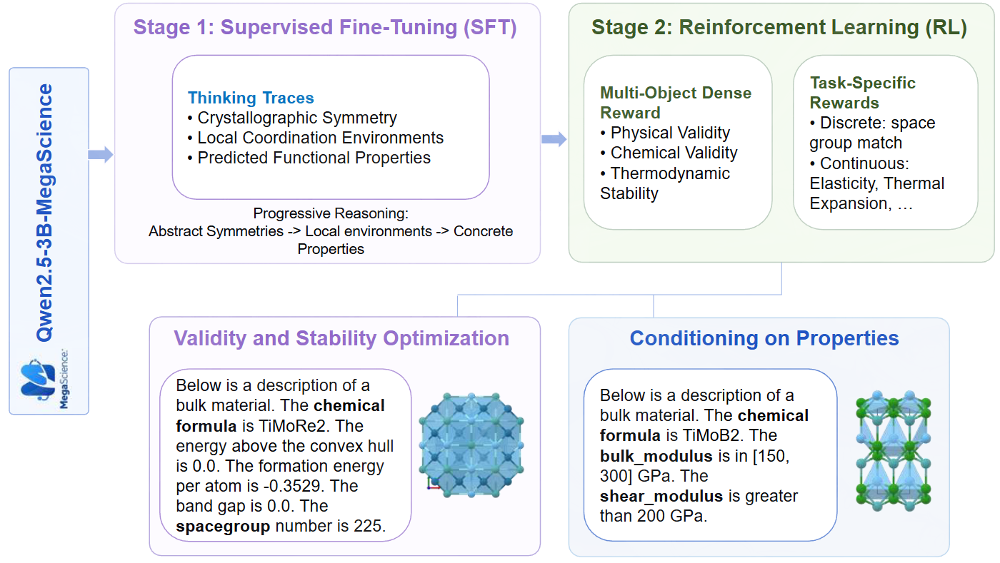

<div align="center">
<h1>CrystalReasoner: Reasoning and RL for Property-Conditioned Crystal Structure Generation<br>
</h1>
</div>

CrystalReasoner (CrysReas) is an end-to-end LLM framework for generating crystal structures from natural language instructions. It uses supervised fine-tuning (SFT) to teach crystal-structure generation, thinking traces to introduce crystallographic and physical priors before coordinates, and reinforcement learning (RL) with verifiable rewards to improve validity, stability, and property conditioning. Please see our work at [crystalreasoner.github.io](https://crystalreasoner.github.io/).

<h4 align="center">
  
[](https://github.com/wyy603/CrystalReasoner/)
[](https://crystalreasoner.github.io/)
[](https://huggingface.co/CrystalReasoner)
[](https://arxiv.org/abs/2605.14344)
</h4>



## 🔗 Resources

| Model Name | Notes |
| --- | --- |
| [🤗 Qwen2.5-3B-CrysReas](https://huggingface.co/CrystalReasoner/Qwen2.5-3B-CrysReas) | Our model with both SFT and RL optimization. |
| [🤗 Qwen2.5-3B-CrysReas-SpaceGroup](https://huggingface.co/CrystalReasoner/Qwen2.5-3B-CrysReas-SpaceGroup) | Space-group property specialist. |
| [🤗 Qwen2.5-3B-CrysReas-ElasticProperties](https://huggingface.co/CrystalReasoner/Qwen2.5-3B-CrysReas-ElasticProperties) | Elastic-property specialist. |
| [🤗 Qwen2.5-3B-CrysReas-ThermalExpansion](https://huggingface.co/CrystalReasoner/Qwen2.5-3B-CrysReas-ThermalExpansion) | Thermal-expansion specialist. |

The first model is our main model. The subsequent models were optimized for property conditioning. **You can directly use them to inference without installing our repo. Our repo is for training and evaluation.** See how to use them to inference in the huggingface pages.

## ⚙️ Installation

### Python Environment

The easiest way to install prerequisites is via [uv](https://github.com/astral-sh/uv), a fast Python package and project manager.

Assumes you are running Linux and have a CUDA GPU. The CrysReas environment can be installed via the following command. Notably, the torch version will be 2.8.0+cu128 because of Verl, and we adjust other modules to fit its torch version.

```bash
# Better for building
export MAX_JOBS=8

# Initialize the environment
uv venv .venv --python 3.12
source .venv/bin/activate

# Basics
uv pip install pip
uv pip install -e .
uv pip install -r requirements.txt
uv pip install ninja

# Install Verl
bash submodules/verl/scripts/install_vllm_sglang_mcore.sh

# Install torch-sim
uv pip install -e "submodules/torch-sim[mace,test]"

# Install mattergen
uv pip install torch-cluster -f https://data.pyg.org/whl/torch-2.8.0+cu128.html
uv pip install torch-scatter -f https://data.pyg.org/whl/torch-2.8.0+cu128.html
uv pip install torch-sparse -f https://data.pyg.org/whl/torch-2.8.0+cu128.html
uv pip install -e submodules/mattergen

# Some fix, you may not need them? But if you encounter problems, try to use them.
uv pip install e3nn==0.4.4
uv pip install mattersim==1.2.0
uv pip install "numpy<2.2"
uv pip install "ase==3.25.0"
uv pip install -U mp-api emmet-core
uv pip install pymatgen==2024.10.29
```

Optionally, you can install apex for better training and inference.

```bash
# Clone apex somewhere and install.
export FORCE_CUDA=1
git clone https://github.com/NVIDIA/apex.git
cd apex
APEX_CPP_EXT=1 APEX_CUDA_EXT=1 pip install -v --no-build-isolation .
```

### Dataset Preparation

Please download `assets/MP/MP_shelve.parquet` via Github LFS (`git lfs pull`) or [HF Hub](https://huggingface.co/datasets/CrystalReasoner/CrystalReasoner-MP), then convert it to the python `shelve` database every other component reads:

```bash
python scripts/parquet_to_shelve.py --write
```

The flag is required: without it the script reports what it would restore and
writes nothing. Add `--overwrite` to replace an existing database. The result,
`assets/MP/MP_shelve`, holds the ground truth used by training, generation and
the metric pipeline.

See [`doc/DATASET.md`](doc/DATASET.md) to understand how this dataset is created from Materials Project. See [`doc/METRICS.md`](doc/METRICS.md) for the metric names and required inputs.

### MP2020Correction

MatterGen's MP2020 correction file is also required for energy-above-hull evaluation:

```bash
curl -L -o submodules/mattergen/data-release/alex-mp/reference_MP2020correction.gz \
  https://github.com/microsoft/mattergen/raw/main/data-release/alex-mp/reference_MP2020correction.gz
```

## 🚀 Training, Generation, and Validation

You can follow these instructions to recreate our checkpoints and run our experiments.

[`scripts/run.py`](scripts/run.py) is the main entrypoint. It reads experiment definitions from [`scripts/config.py`](scripts/config.py).

```bash
python scripts/run.py [-h] [--experiment STR] [--output STR] [--dry_run | --no_dry_run] [extra overrides...]
```

It supports SFT, RL/GRPO, generation, checkpoint merge, and evaluating metrics through one registry.

Before training, you must set environment variables `SWANLAB_API_KEY` and `HF_TOKEN`. Notably, you can write `.env` file in the project folder to do this.

In default the output of this script is **located at `logs/{experiment_name}.out`** and will not be printed directly to the command line. To output to the terminal, set `--output=terminal`. To use a timestamped log file, set `--output=time`.

Common examples:

```bash
# Supervised fine-tuning baselines
python scripts/run.py sft_no_thinking
python scripts/run.py --output=terminal sft_no_thinking
python scripts/run.py sft_thinking
python scripts/run.py sft_thinking gpu=2

# Merge FSDP checkpoints into Hugging Face format
python scripts/run.py merge \
  --path checkpoints/thinking/global_step_1514 \
  --output-path checkpoints_merged/thinking

# Generate samples from a merged checkpoint
python scripts/run.py generate checkpoints_merged/thinking

# RL/GRPO alignment from a merged SFT checkpoint
python scripts/run.py rl_thinking_novel

# Run metric_process through the unified runner
python scripts/run.py run_metric \
  --path checkpoints_merged/thinking/conditional+thinking.parquet \
  --metrics-name composition_consistency spacegroup_consistency stable_unique_novel \
  --prompt-type conditional+thinking \
  --forced
```

Representative registered jobs include:

- SFT: `sft_no_thinking`, `sft_thinking`, `sft_crystaltextllm`, `sft_crystaltextllm_8`, `sft_plaid_wyckoff`, `sft_plaid_wyckoff_8`
- RL/GRPO: `rl_no_thinking`, `rl_thinking`, `rl_thinking_novel`, `rl_spacegroup_thinking`, `rl_elastic_thinking_new`, `rl_cte_thinking`
- Generation: `generate`, `generate_rl`, `generate_elastic`, `generate_cte`, `generate_crystaltextllm`, `generate_plaid_wyckoff`
- Metrics: `run_metric`, `metric_qha`, `metric_elastic`
- Checkpoint conversion: `merge`

See [`doc/TRAINING.md`](doc/TRAINING.md) for training details.

## 📊 Evaluation

Evaluation runs in two stages. `crysreas.metric_process` scores every generated
structure and writes one column per judgement; `crysreas.experiment.evaluate`
turns those columns into rates, error bars and tables. Keeping them separate is
what lets a table be traced back to the rows behind it.

### 1. Generate

```bash
python scripts/run.py generate checkpoints_merged/thinking
```

This draws `data.n_samples` structures for each of the 1,024 held-out
compositions in `assets/MP/split_generation.json` and writes
`checkpoints_merged/thinking/conditional+thinking.parquet`. Override the sample
count on the command line:

```bash
python scripts/run.py generate checkpoints_merged/thinking data.n_samples=10
```

Sample `j` of every prompt is read as seed `j`, so `n_samples` is the number of
seeds and each seed is one complete evaluation of the split.

### 2. Score every structure

```bash
python -m crysreas.metric_process \
  --path checkpoints_merged/thinking/conditional+thinking.parquet \
  --metrics-name spacegroup_stable_unique_novel \
  --prompt-type conditional+thinking \
  --num-workers 1
```

Name only the metric you want; dependencies are resolved and run in order. The
command above pulls in parsing, both validity checks, composition and space
group consistency, relaxation, hull distance, stability, uniqueness, novelty,
S.U.N. and S.S.U.N. Use `--num-workers 1` for anything MLIP-backed, and
`--forced` to recompute columns a previous pass already wrote.

Metric groups:

- Parsing and validity: `simple_structure`, `structure_validity`, `smact_validity`
- Instruction following: `gt`, `composition_consistency`, `spacegroup_consistency`
- Relaxation and energy: `relaxed_structures`, `energy_above_hull`, `is_stable`, `is_metastable`
- Discovery: `stable_unique_novel` (S.U.N.), `spacegroup_stable_unique_novel` (S.S.U.N.)

`stable_unique_novel` also writes the `is_unique` and `is_novel` columns; both
are outputs, and neither is a name you pass to `--metrics-name`.
- Property rewards: `energy_reward`, `smooth_energy_reward`, `elastic_reward`, `cte_reward`
- Property calculations: `fmax`, `elastic_properties`, `cte`

### 3. Produce the results

```bash
python -m crysreas.experiment.evaluate \
  checkpoints_merged/thinking/conditional+thinking.parquet \
  checkpoints_merged/no_thinking/conditional+thinking.parquet \
  --names CrysReas-Thinking CrysReas-Base
```

Add `--latex` for a `tabular` ready to paste into a manuscript. From Python,
`compare`, `to_latex` and `separation` cover the same ground.

Each rate is the mean over seeds of the per-seed rate, and each error bar is the
standard error across seeds, so the bars report run-to-run variation. They
exclude the variation that comes from choosing which compositions to evaluate
on, which makes them incomparable with a per-composition clustered standard
error. With few seeds a visible gap is often not a separation; call
`evaluate.separation(a, b, metric)` before claiming one.

### The four judgements

S.U.N. and S.S.U.N. rest on four questions, each configurable in
`crysreas.metric_process.config`:

| Judgement | Key | Default |
|---|---|---|
| Is it stable? | `stability_threshold` | `E_hull <= 0` |
| …metastable (S.S.U.N. only)? | `metastability_threshold` | `E_hull <= 0.1` |
| Does it carry the requested symmetry? | `spacegroup_criterion` | `subgroup` |
| Is it novel? | `novelty_reference` | `train` |
| Is it unique? | `uniqueness_scope` | `seed` |

`mattergen_config()` collects MatterGen's setting for all four. S.U.N. and
S.S.U.N. sit on different energy windows on purpose, so S.S.U.N. is the larger
of the two despite carrying one more factor, and the two should not be read
against each other.

[`crysreas/experiment/README.md`](crysreas/experiment/README.md) explains what
each judgement measures and where it misleads.
[`doc/METRICS.md`](doc/METRICS.md) lists every registered metric with its column
dependencies and serialization behaviour.

### Checking the implementation

```bash
python -m crysreas.experiment.verify_equivalence
```

Re-derives each stored column from the configurable implementation and compares
it row by row against the evaluation artifacts.

## 🤗 Checkpoints and Results

After training, the checkpoint is genreated in `checkpoints/`. After merging, it is in `checkpoints_merged/`.

Precomputed experiment checkpoints are available at huggingface, will the sample outputs are available in the `checkpoints_merged` folder of this repo. Below is the relation between the parquets in `checkpoints_merged` folder and the huggingface models:

| Folder name in `checkpoints_merged` | Model Name | Notes |
| --- | --- | --- |
| `no_thinking` | [🤗 Qwen2.5-3B-CrysReas-Base](https://huggingface.co/CrystalReasoner/Qwen2.5-3B-CrysReas-Base) | SFT baseline without thinking traces. |
| `thinking` | [🤗 Qwen2.5-3B-CrysReas-Thinking](https://huggingface.co/CrystalReasoner/Qwen2.5-3B-CrysReas-Thinking) | SFT baseline with thinking traces. |
| `rl_no_thinking` | [🤗 Qwen2.5-3B-CrysReas-RL](https://huggingface.co/CrystalReasoner/Qwen2.5-3B-CrysReas-RL) | RL from the no-thinking baseline. |
| `rl_thinking_mix` | [🤗 Qwen2.5-3B-CrysReas](https://huggingface.co/CrystalReasoner/Qwen2.5-3B-CrysReas) | Our model with both SFT and RL optimization. |
| `thinking_only_validity` | [🤗 Qwen2.5-3B-CrysReas-NoEnergyTerm](https://huggingface.co/CrystalReasoner/Qwen2.5-3B-CrysReas-NoEnergyTerm) | Validity-focused ablation (no energy term). |
| `thinking_only_energy` | [🤗 Qwen2.5-3B-CrysReas-NoValidityTerm](https://huggingface.co/CrystalReasoner/Qwen2.5-3B-CrysReas-NoValidityTerm) | Energy-focused ablation (no validity term). |
| `spacegroup_thinking` | [🤗 Qwen2.5-3B-CrysReas-SpaceGroup](https://huggingface.co/CrystalReasoner/Qwen2.5-3B-CrysReas-SpaceGroup) | Space-group property specialist. |
| `rl_elastic_thinking_new` | [🤗 Qwen2.5-3B-CrysReas-ElasticProperties](https://huggingface.co/CrystalReasoner/Qwen2.5-3B-CrysReas-ElasticProperties) | Elastic-property specialist. |
| `rl_cte_thinking` | [🤗 Qwen2.5-3B-CrysReas-ThermalExpansion](https://huggingface.co/CrystalReasoner/Qwen2.5-3B-CrysReas-ThermalExpansion) | Thermal-expansion specialist. |
| `crystaltextllm` | [🤗 Qwen2.5-3B-CrysReas-CrystalTextLLM](https://huggingface.co/CrystalReasoner/Qwen2.5-3B-CrysReas-CrystalTextLLM) | Prior-work text format reimplementation. |
| `plaid_wyckoff` | [🤗 Qwen2.5-3B-CrysReas-PLaIDWyckoff](https://huggingface.co/CrystalReasoner/Qwen2.5-3B-CrysReas-PLaIDWyckoff) | Prior-work Wyckoff representation reimplementation. |

See more in [`doc/CHECKPOINTS.md`](doc/CHECKPOINTS.md).

## 🖥️ Hardware Notes

The default configuration assumes:

- At least 1 GPU for SFT.
- At least 2 GPUs for RL/GRPO jobs.
- At least 1 GPU for MLIP-backed reward or metric calculations.
- At least 4 CPUs cores for typical training and evaluation jobs.

Some registered jobs request more CPU memory and CPU cores in [`scripts/config.py`](scripts/config.py), especially elastic and CTE tasks.

## 📚 Citation

If you find our work useful, please cite:

```
@article{wu2026crysreas,
  title={CrystalReasoner: Reasoning and RL for Property-Conditioned Crystal Structure Generation},
  author={Yuyang Wu and Stefano Falletta and Delia McGrath and Sherry Yang},
  year={2026},
  journal={arXiv preprint arXiv:2605.14344},
  url={https://arxiv.org/abs/2605.14344}
}
```
